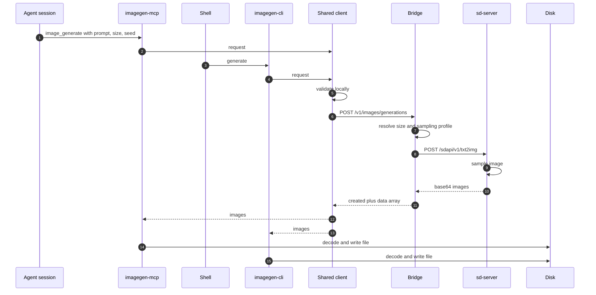

imagegen — a local image service behind the OpenAI image API

Document control

  Identifier      IMAGEGEN-README
  Revision        2.0
  Status          Approved for public release
  Issue date      2026-11-24
  Owner           repository maintainers
  Classification  Public
  Applies to      this repository at the commit carrying this revision
  Supersedes      revision 1.0 (recipe scaffold)
  Related         docs/WORKFLOW.md, docs/REFERENCE.md, docs/architecture.md

Dates in this repository use the calendar date form YYYY-MM-DD. Numbers that
carry a unit state the unit. Every technical statement here is checkable
against the source in this repository; where a statement rests on a
measurement taken once, it says so and names the machine.

1. Purpose

This repository provides a complete, self-contained image generation service
that speaks the OpenAI image API. It exists so that any client able to address
that API can create and edit images with models running on local hardware,
without a hosted vendor in the path.

The service is deliberately generic. It has no knowledge of the application
that calls it, and the bundled command-line client and agent tool server are
convenience front ends over the same public interface.

2. Scope

In scope:

  - the bridge that exposes the OpenAI image routes and supervises the
    generation backend;
  - the command-line client;
  - the agent tool server;
  - the recipe for obtaining model files and running the backend;
  - the measurements and quality evidence behind the shipped configuration;
  - instructions for an operator, a maintainer, and an integrating developer.

Out of scope:

  - training or tuning a model;
  - hosting for other users, authentication for remote callers, and transport
    security;
  - the model files themselves, which are downloads and are never committed.

3. Intended readers

  Reader                        Uses this repository to
  ----------------------------  -------------------------------------------------
  Operator                      start, stop, probe and use the service
  Integrating developer         call the API from an application or a script
  Maintainer                    change the model stack, rebuild, re-measure
  Reviewer                      check that a change keeps the stated guarantees

4. System overview

Four components make the service. Each has one responsibility, and none of them
requires the others to be a particular vendor.

  Component    Form                    Responsibility
  -----------  ----------------------  -----------------------------------------
  backend      sd-server process       loads the models and performs sampling
  bridge       Rust HTTP server        OpenAI routes, request translation,
                                       backend supervision
  client       Rust library            one HTTP contract, shared by both front
                                       ends below
  front ends   imagegen-cli            shell access
               imagegen-mcp            agent access

The backend is the only component that needs a GPU. The bridge binds to a
loopback address by default, and the two front ends talk to the bridge over
HTTP like any other client would.

5. How a request travels

The diagram shows one generation from an agent session through to a file on
disk. The shell path is identical from the bridge onward; only the entry point
differs.

Both entry points reach the bridge through the same client library, which is
why the two paths converge before the request leaves the machine.

The flow has four decision points worth naming:

  - validation happens twice on purpose: the shared library rejects a malformed
    request before a round trip, and the bridge rejects it again so a direct
    caller cannot bypass the rules (crates/bridge/src/main.rs:839);
  - the backend is spoken to on its native route, because the OpenAI route
    would silently drop fields such as seed and step count;
  - the sampling profile is chosen per request, either from the live mode or
    from an explicit flag on that request;
  - the image is written by the caller, not by the service, so a caller decides
    where its artifacts live.

6. Capabilities

The service provides the following, all through the OpenAI image API shape:

  - text to image;
  - a model list;
  - a health probe that reports backend liveness and the live sampling state;
  - a sampling mode switch for a few-step accelerator, when one is configured;
  - image to image, when the bridge was started with a vision tower.

Image to image needs the backend's vision tower, which is the `llm_vision` key.
Qwen Image 2.1 conditions on a reference image by running it through that tower,
so without it the backend returns no image at all. A bridge started without the
key refuses an edit with 501 and that reason rather than attempting it, and
generation is unaffected either way. Verified live on 2026-11-24: a 512x192 edit
returned HTTP 200 with a PNG in 27 s.

Two ways to reach few-step generation exist, and they differ:

  - a turbo-native checkpoint carries the acceleration in its weights and needs
    only its published schedule, so no adapter and no adapter directory are
    involved;
  - an adapter turns a base checkpoint into a few-step generator at runtime,
    which costs extra memory and adds a file and a schedule.

The shipped recipe includes both. The turbo-native path is the one measured most
recently and the one in recipe.json's turbo-native profile.

7. Obtaining the model files

recipe.json lists every file a deployment needs: its path in this repository,
its exact byte size, its checksum, its public source, and which sampling
profiles use it. recipe.schema.json states the rules the recipe satisfies.
tools/recipe-check.sh verifies what is on disk against the recipe:

    tools/recipe-check.sh --schema
    tools/recipe-check.sh --profile turbo-native
    tools/recipe-check.sh --download q4-k-m-turbo

A download is checked against the recorded size and checksum as part of the
download, so a truncated or substituted file fails rather than proceeding.

8. Requirements

  - Linux, a recent Rust toolchain, and a GPU with enough memory for the chosen
    model, or a CPU-only setup at much lower speed;
  - approximately 11 GiB of disk for the model stack described in
    models/MANIFEST.md;
  - a C toolchain to build the backend from its own project.

The measured reference machine is an RTX 4070 SUPER with 12 GiB of video
memory. A larger card relaxes the size ceiling described in section 9; a
smaller one lowers it.

9. Getting started

The short form, for an operator with the model files already in place:

    bash <build-root>/linux/build.sh -p <project-root> --all
    cd <project-root>
    IMAGEGEN_CONFIG=imagegen.toml bin/imagegen-bridge
    bin/imagegen-cli health
    bin/imagegen-cli generate -p "a lighthouse at dusk" -o out/light.png

The build step produces every binary in bin/. The bridge reads imagegen.toml
from its working directory unless IMAGEGEN_CONFIG names another file. The
client and the tool server discover the endpoint through their own settings;
both default to the local bridge.

The full procedure, including model download, backend compilation, and the
wire-up for an agent client, is docs/WORKFLOW.md.

10. Configuration

Configuration order, highest priority first: a command-line flag, then the
environment, then the configuration file, then a built-in default. This order
is the same for every component and is stated in each component's help text.

The settings that shape behaviour:

  Setting                    Effect
  -------------------------  --------------------------------------------------
  endpoint base URL          where the client sends requests
  API key                    bearer token, read from the environment only
  request timeout            total time allowed for one request
  listen address             where the bridge binds; loopback by default
  model paths                diffusion, encoder, and decoder files
  backend placement          which modules run and live on GPU or CPU
  sampling defaults          steps and guidance for the base profile
  accelerator settings       adapter, multiplier, and schedule for turbo

No endpoint address, credential, or host path is compiled into the binaries.
A missing model path is a startup error that names what is missing, never a
silent fallback to a different model.

11. API reference

The full reference, with every field and every error, is docs/REFERENCE.md.
The summary:

  Method  Route                      Purpose
  ------  -------------------------  -----------------------------------------
  GET     /v1/models                 model list
  POST    /v1/images/generations     text to image
  GET     /v1/turbo                  live sampling mode
  POST    /v1/turbo                  switch sampling mode
  GET     /health                    liveness and backend state

Sizes are expressed either as an explicit width by height, both divisible by
32, or as an aspect ratio plus a resolution tier. The bridge applies a maximum
edge of 1536 pixels on the reference card and rejects a larger request with a
clear message (crates/bridge/src/main.rs:973).

12. Quality and known limits

The shipped configuration, its measured cost, and its quality rating are
recorded in docs/sampling-profiles.md, in qa-evidence/, and in the measured
block of each profile in recipe.json. The turbo-native measurement is recorded
in full, with its reproduction command and its limits, in
docs/verification-turbo-2026-11-24.md.

The few-step profile was verified on the reference card on 2026-11-24 with the
turbo-native checkpoint: eight steps, guidance 1.0, the published schedule, and
1024 by 1024 output. With the decoder on the GPU, an isolated run took 14
seconds: 10.9 seconds of sampling, 1.7 seconds of decoding. Peak video memory was
11,515 of 12,282 MiB. Leaving the decoder on the CPU cost 70 seconds of decode
for the same image, which is why the recipe places the decoder on the GPU.

Limits that a caller should know:

  - one image per request through the bridge;
  - a maximum edge of 1536 pixels on the reference card;
  - the turbo-native profile reaches 11,515 MiB of video memory, under 800 MiB
    of headroom, so a smaller card must move the decoder to the CPU or lower
    the size;
  - image to image needs the vision tower (`llm_vision`) and is refused with 501
    without it;
  - the backend holds the card while it runs: it releases it after
    `idle_timeout_secs` with no request, and `imagegen-cli lifecycle` reports
    whether a stop is safe.

13. Repository layout

  Path                     Contents
  -----------------------  --------------------------------------------------
  crates/bridge            the HTTP service
  crates/client            the shared HTTP client
  crates/cli               the command-line client
  crates/mcp               the agent tool server
  crates/convrot-verify    an encoder verification tool
  docs/                    the document set
  models/MANIFEST.md       model registry, never the model files
  recipe.json              the machine-readable model recipe
  recipe.schema.json       the rules the recipe satisfies
  packaging/hooks          optional lifecycle scripts
  patches/                 backend patches, only for one encoder variant
  qa-evidence/             quality evidence and reports
  tests/                   the test entry point and the review gate
  tools/recipe-check.sh    verifies downloaded files against the recipe

14. Building and testing

Build every binary with the shared builder:

    bash <build-root>/linux/build.sh -p <project-root> --all

Run the tests:

    bash tests/run.sh

The test entry point runs the Rust suite and the review gate. The gate is a
review step, not a per-commit activity; it is described in docs/WORKFLOW.md.

15. Security and privacy

The service holds no credentials beyond an optional bearer token, and it never
logs one. The bridge binds to loopback by default and has no authentication of
its own, so exposing it beyond the machine requires a proxy that adds
authentication and transport security. Do not place a credential in a
command-line flag; the client reads its key from the environment only, so a key
does not enter shell history or a process listing.

16. Normative references

The service implements the image portion of the OpenAI API. When this document
and the implementation disagree, the implementation and its tests are
authoritative, and this document is corrected.

17. Document set

  Document                Audience        Question it answers
  ----------------------  --------------  -----------------------------------
  README.md               all             what this is, and how it fits
  docs/WORKFLOW.md        operator        how do I run it, step by step
  docs/REFERENCE.md       developer       what exactly can I send
  docs/architecture.md    maintainer      why is it built this way
  docs/verification-turbo-2026-11-24.md   reviewer  what was measured, and how
                                          to repeat it
  docs/sampling-profiles.md               reviewer  the profiles and their costs

18. Maintenance

A change that alters behaviour, the interface, or a dependency updates the
reference and the workflow in the same change. A change that alters a measured
claim updates the evidence beside the claim. Every change carries a message in
the conventional form, with a body that states what was verified and how.

Licence: MIT.
